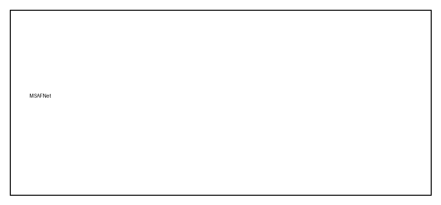
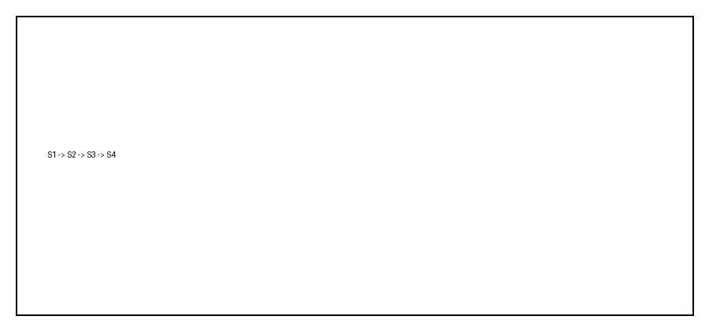

::: 摘要
本发明公开了一种基于多尺度非对称融合网络的水稻分布智能制图方法，涉及农业遥感技术领域。针对现有技术中多模态特征融合未兼顾模态独立性与类别不平衡、复杂环境下制图精度不足的问题，本方法整合多源卫星遥感数据并预处理，构建融合几何、物候及生态特征的样本集，采用双分支参数不共享的编码结构提取特征，在融合阶段以多尺度语义增强与类别平衡特征融合实现自适应加权，最后经解码重建得到高分辨率制图结果。本方法在云雾干扰与地块破碎条件下显著提升了识别精度与鲁棒性。

::: 摘要附图

::: 权利要求书
1.一种基于多尺度非对称融合网络的水稻分布智能制图方法，其特征在于，包括如下步骤：

S1、整合多源卫星遥感数据确定多模态遥感影像数据集，并对所述多模态遥感影像数据集进行预处理；

S2、基于预处理后的多模态遥感影像数据集构建融合几何、物候及生态特征的RGB-SAR多模态遥感样本集，自动识别并标注具有水稻物候特征的样本区域；

S3、采用多尺度非对称融合网络对所述RGB-SAR多模态遥感样本集进行特征提取，并在特征融合阶段实现多尺度特征互补与类别自适应权重分配；

S4、将多尺度非对称融合网络输出的特征图进行解码重建，生成高分辨率水稻分布制图结果。

2.根据权利要求1所述的方法，其特征在于，所述多源卫星遥感数据包括光学遥感影像和SAR雷达影像。

3.根据权利要求1所述的方法，其特征在于，所述多尺度非对称融合网络采用双分支并行编码架构，两个分支的权重不共享。

::: 说明书
# 一种基于多尺度非对称融合网络的水稻分布智能制图方法

## 技术领域

本发明涉及农业遥感与智能信息处理技术领域，具体涉及一种基于多尺度非对称融合网络的水稻分布智能制图方法。

## 背景技术

随着遥感技术的发展，多源卫星影像已广泛应用于农业监测等领域。传统水稻制图多依赖单一光学或雷达影像，受限于样本不足、气象干扰和训练样本稀缺，难以实现高效高精度的自动化制图。

光学影像虽具空间与光谱优势，但易受云雾等影响，数据获取不连续；SAR影像具全天候成像能力，可补充光学影像时空缺失。

因此，如何在多模态遥感数据融合中兼顾互补性、独立性与类别平衡，是当前亟需解决的技术难题。

## 发明内容

本发明的目的在于提供一种基于多尺度非对称融合网络的水稻分布智能制图方法，解决以下技术问题：

怎样实现多模态遥感制图在水稻分布高精度自动化识别。

本发明的目的可以通过以下技术方案实现：

一种基于多尺度非对称融合网络的水稻分布智能制图方法，包括如下步骤：

S1、整合多源卫星遥感数据确定多模态遥感影像数据集，并对所述多模态遥感影像数据集进行预处理；

S2、构建融合几何、物候及生态特征的RGB-SAR多模态遥感样本集；

本发明的有益效果：

（1）本发明通过融合SAR雷达影像与多光谱光学影像，构建多模态时空遥感影像数据集，显著提升了样本代表性和数据质量。

（2）本发明在网络结构上引入多尺度非对称融合机制，有效提升了对碎片化田块的识别能力。

当然，实施本发明的任一产品并不一定需要同时达到以上描述的所有优点。

## 附图说明

为了更清楚地说明本发明实施例的技术方案，下面将对实施例描述所需要使用的附图作简单地介绍，显而易见地，下面描述中的附图仅仅是本发明的一些实施例，对于本领域普通技术人员来讲，在不付出创造性劳动的前提下，还可以根据这些附图获得其他的附图。

图1为本发明方法的步骤图；

图2为本发明方法的框架示意图。

## 具体实施方式

下面将结合本发明实施例中的附图，对本发明实施例中的技术方案进行清楚、完整地描述，显然，所描述的实施例仅仅是本发明一部分实施例，而不是全部的实施例。基于本发明中的实施例，本领域普通技术人员在没有做出创造性劳动前提下所获得的所有其他实施例，都属于本发明保护的范围。

请参阅图1-2所示，一种基于多尺度非对称融合网络的水稻分布智能制图方法，具体包括以下步骤：

步骤1：整合多模态遥感影像数据集。

对获取的影像数据进行预处理，主要包括去噪、图像对齐、数据标注等操作。

步骤2：多模态样本区自动提取与标注。

采用空间过滤与质心向量法纯化候选区，建立高代表性样本集。

步骤3：多尺度非对称融合网络结构设计与特征提取。

本步骤通过构建多尺度非对称融合网络，实现对多模态遥感影像的高效特征提取与融合。该网络采用双分支并行编码架构。

（1）多尺度语义增强模块：对输入特征图分别用不同尺度的最大池化进行下采样，提取多尺度的空间特征，公式表达为：

$$
P_s^{rgb}(X) = \mathrm{MaxPool}_{s \times s}(X),\quad s \in S
$$ (1)

其中，\(X\) 指输入的RGB影像特征图，\(\mathrm{MaxPool}\) 是最大池化操作，\(S\) 为池化的尺度集合。

使用以下方程计算相关变量：

$$
NDVI = \frac{\rho_{NIR} - \rho_{Red}}{\rho_{NIR} + \rho_{Red}}
$$ (2)

其中，\(\rho_{NIR}\)、\(\rho_{Red}\) 分别表示近红外与红光的地表反射率，\(NDVI\) 为归一化植被指数。

（2）类别平衡特征融合模块：通过三路注意力机制和可调节类别平衡机制，动态调整各模态特征的贡献权重。

步骤4：特征解码与高分辨率制图。

将融合后的特征图输入到改进的解码结构中进行解码重建。

进一步地，验证水稻分布制图的推理与应用，定量对比结果见表1。

表1

| 模型 | 模态 | Kappa | mIoU |
|------|------|-------|------|
| 方法A | opt | 74.06 | 85.72 |
| 方法B | sar | 61.63 | 78.43 |
| 本发明 | opt+sar | 82.18 | 91.27 |

为便于阅读，表格中各项英文缩写的中文含义如下：Kappa—卡帕系数；mIoU—平均交并比。

本说明书中的各个实施例均采用递进的方式描述，各个实施例之间相同相似的部分互相参见即可，每个实施例重点说明的都是与其他实施例的不同之处。尤其，对于装置、设备、非易失性计算机存储介质实施例而言，由于其基本相似于方法实施例，所以描述的比较简单，相关之处参见方法实施例的部分说明即可。

以上内容仅仅是对本发明的构思所作的举例和说明，所属本技术领域的技术人员对所描述的具体实施例做各种各样的修改或补充或采用类似的方式替代，只要不偏离发明的构思或者超越本申请所定义的范围，均应属于本发明的保护范围。

::: 说明书附图

